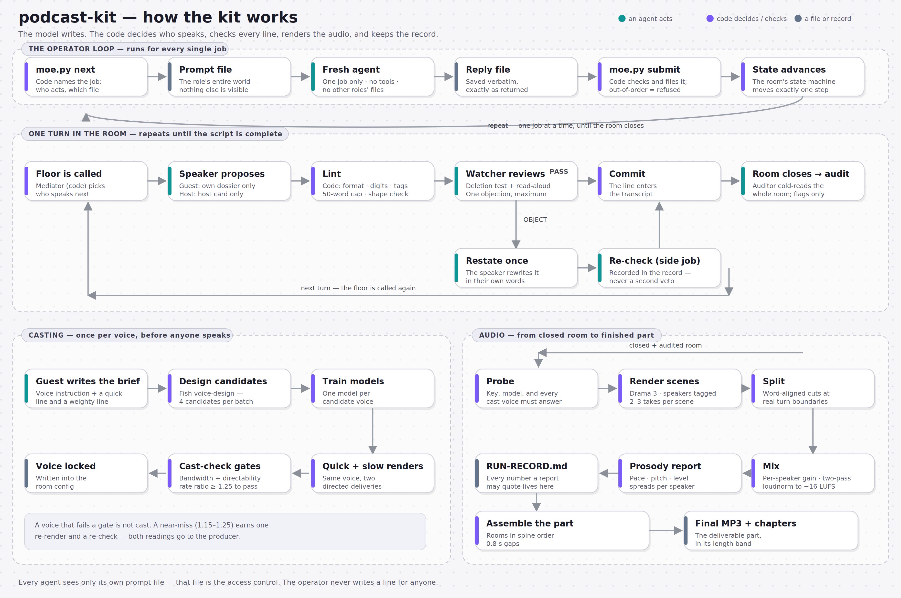

# podcast-kit: a conversation-room pipeline, as code

License: MIT (see LICENSE)

This is a sanitized public copy of an internal production kit for an
openly AI-made podcast: a show whose host and guests are AI-built
characters, disclosed to listeners as such, each played by a separate
agent. All names, voices, occasions and governing documents from the
original production have been replaced with fictional examples and
generic templates (see `SANITIZATION-LOG.md`). Adapt it to your own
show; the machinery is the point.



*The whole flow at a glance: the operator loop, one turn in the room, casting, and the audio chain.*

## The idea in one paragraph

Every rough spot in the manual version of this pipeline traced back to
the same place: the operator doing, by hand, work that a program
should do - passing proposals between agents as file plumbing, typing
statistics into records, assembling each agent's context by hand,
leaving levels and joins uncorrected, and keeping the rules spread
across many documents and rulings. The kit turns the pipeline into a
state machine. The model writes; the code decides who speaks, builds
each agent's prompt with only what that role may see, checks every
reply, validates the watcher, counts everything, renders, mixes and
writes the record. The operator runs `moe.py next`, hands a file to a
fresh agent, saves the reply, and runs `moe.py submit`. Out-of-order
steps are refused.

## What's in it

| path | what |
|---|---|
| `SKILL.md` | the runbook: ten rules, setup, room prep, the loop, render/mix/deliver, re-tag pass, casting, episode assembly, troubleshooting |
| `moe.py` | the CLI (`python moe.py help`) |
| `moekit/room.py` | the state machine: mediation, prompt assembly, reply parsing, watcher validation, commits, scratch/transcript records |
| `moekit/lint.py` | every rule code can check: format, digits, tag syntax/budget, name-only floor offers (producer ruling), the 50-word guest limit, structural spent-shape, contractions, clause density, delivery cells |
| `moekit/audio.py` | text-to-speech render (scene/turn modes), scene-take splitter, per-speaker mix, prosody report, episode/part assembly |
| `moekit/casting.py` | voice casting: guest-authored instruction (validated), bandwidth + directability gates |
| `moekit/record.py` | RUN-RECORD.md generated from state; only the mediator-notes block is hand-written |
| `prompts/` | the role prompts: guest, host, watcher, auditor, re-tag, cast. Short, self-contained, one strict reply format each |
| `templates/` | generic stand-ins for the governing documents the prompts were written against: `AVOID-LIST.md`, `PRESENTATION.md`, `PIPELINE.md`, `PRODUCER-NOTES.md` - replace with your own |
| `SOURCES.json` | hashes of the template documents in `templates/`; `moe.py doctor --docs templates` flags changes |
| `examples/` | fictional example personas, occasions and room configs (`one-on-one/`, `panel/`), an episode-part assembly example, and the one-line agent system prompt |
| `tests/` | notes on how the kit was exercised (live-run outputs are not included; see `tests/README.md`) |

## What was tested in the original production

- **Linter against a known-bad transcript:** with no model judgment,
  it reproduced a human review's findings (over-long guest turns, a
  repeated host turn shape, zero short turns, almost no contractions).
- **Mock-agent rooms** (scripted agents that misbehave on purpose):
  full loops of 180+ actions - format repairs, invented watcher
  phrases rejected, valid objections leading to restatement, re-check
  and commit, close, audit, record. Solo (host-only) segments and
  cross-room continuity were also exercised.
- **Audio chain on real audio:** an earlier room imported, re-tagged,
  scene-planned, split, mixed, reported and recorded; the splitter
  recovered all true turn boundaries within 10 ms, and the mix landed
  on the target loudness with per-speaker gains.
- **Live rooms with a small model** standing in for the operator's
  usual model (every agent fresh, no tools). Each run found something
  the kit now enforces: the watcher missing the shared brief, length
  budgets ignored, booked friction never happening, example delivery
  directions being copied, a topic stall, a guest declining the role
  because the prompt did not say the show discloses its AI guests, and
  copied marks being committed after failed repairs.
- **Parallel mode:** two drafts per turn with re-checks off the
  critical path used about 38% less wall time than sequential for the
  same size room, with fewer repairs and the fewest audit flags of any
  test run.
- **Real text-to-speech:** the connection probe, a scene render of a
  live room, the word-aligned split (95-98% of words matched), the
  mix, prosody report and record, and the casting gates on real voice
  renders.
- **Panel mediation, live:** host held to about a quarter of turns,
  with most transitions going guest to guest.

**Not tested in the original:** the `--tts-cmd` connector path (use
the HTTP path); voice *design* (candidate generation), which was the
operator's connector rather than the kit; and operation by the
sanitized copy's new example content - the examples are illustrative
fixtures, not production material.

In the panel example, two of the four voices are deliberately left unset (`null`)
in the room config: the kit refuses to run a room until every voice is cast, so
the example doubles as a demonstration of the casting gate. Cast those voices
(or point the config at voices already cast) before starting that room.

## Quick start

```
python moe.py doctor --docs templates
cp -r examples/one-on-one /tmp/my-room
python moe.py new /tmp/my-room --config /tmp/my-room/room.json
python moe.py next /tmp/my-room     # then follow the printed loop
```

Rendering needs a Fish Audio API key in `FISH_API_KEY` (environment
only, never in a file) and ffmpeg/ffprobe on PATH.
